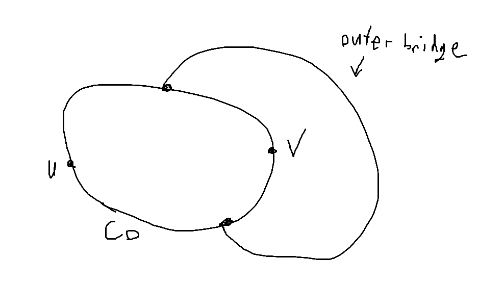
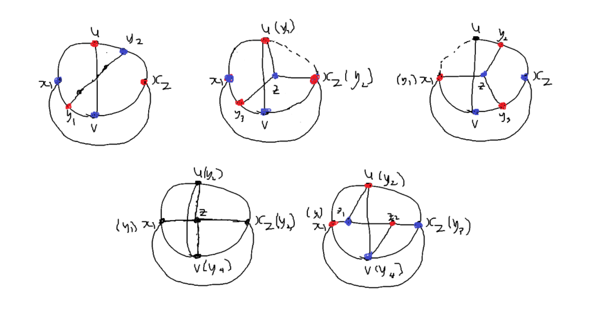
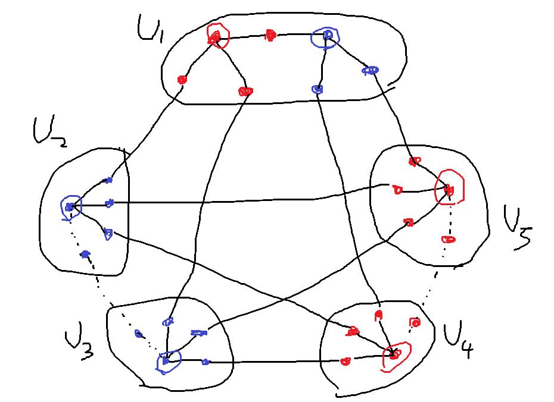

Midterms are boring.

It is well known that a graph is planar if and only if it does not contain $K_5$ and $K_{3, 3}$ as a minor, which is known as Wagner's theorem. Here, we prove this fact.

## The Easy Direction

We first start with the easy direction, which is showing that if a graph is planar, it does not contain $K_5$ and $K_{3,3}$ as a minor. We make use of Euler's formula $v - e + f = 2$.

**Lemma.** For every planar graph that has a minimum cycle of length at least $g \geq 3$,

$$e \leq \frac{g}{g-2}(v-2)$$

*Proof.* Because the minimum cycle has length at least $g$, all faces have size at least $g$. Therefore $fg \leq 2m$, and using Euler's formula we get the desired result. $\blacksquare$

In the case of $K_5$, take $g = 3$, then plugging it in the inequality we get $10 \leq 9$, therefore $K_5$ is not planar. In the case of $K_{3,3}$, take $g = 4$, then we get $9 \leq 8$, therefore $K_{3,3}$ is not planar. Therefore we have proven that a planar graph cannot contain $K_5$ and $K_{3,3}$ as a subgraph.

It is easy to see that a minor of a planar graph is also planar, as vertex/edge deletions and edge contractions can be done without introducing new crossings. Therefore a minor of a planar graph can neither be $K_5$ nor $K_{3,3}$.

In conclusion, we have proven that if a graph is planar, it does not contain $K_5$ and $K_{3,3}$ as a minor.

## The Hard Direction

Showing the converse is a bit more difficult. We start with a stronger version of the theorem, known as the Kuratowski theorem.

### Kuratowski's Theorem

**Theorem.** A graph is planar if and only if it does not contain a subdivision of $K_5$ or $K_{3,3}$ as a subgraph.

A subdivision of a graph $G$ is obtained from $G$ by inserting vertices into edges zero or more times. a direct consequence of what we've proven before shows that a planar graph does not contain a subdivision of $K_5$ or $K_{3,3}$ as a subgraph.

We now prove the converse through a series of lemmas. We start with the following definitions.

**Definition 1.** For a graph $G$, a *vertex cut* $V^\prime$ is a subset of $V$ whose removal makes $G - V^\prime$ disconnected. The connectivity of $G$, denoted by $\kappa(G)$ is the minimum size of the vertex cut $V^\prime$. A graph $G$ is said to be *$k$-connected* if $k \leq \kappa(G)$.

**Definition 2.** For a graph $G$, $H$ is a *proper subgraph* of $G$ if $V(H) \subsetneq V(G)$ and $E(H) \subsetneq E(G)$. A *minimal nonplanar graph* is a nonplanar graph that does not have any nonplanar proper subgraph.

Clearly it suffices to prove the theorem for minimal nonplanar graphs. The proof strategy is as follows:

1. Show that if minimal nonplanar graphs without any subdivision of $K_5$ or $K_{3,3}$ as subgraphs did exist, they would be 3-connected and simple.
2. Show that every 3-connected graph with no subdivision of $K_5$ or $K_{3,3}$ as subgraphs is in fact planar. Then we arrive at a contradiction.

To prove (1), we use a few lemmas.

**Lemma 3.** A minimal nonplanar graph is 2-connected.

*Proof.* First, a minimal nonplanar graph is connected. Suppose $G$ is nonplanar and disconnected. Then all components must be planar (otherwise we can choose the nonplanar component as a subgraph, which makes $G$ not minimal). Then obviously $G$ is planar, which is a contradiction.

We know show that $G$ is 2-connected. Suppose $G$ is nonplanar with $\kappa(G) = 1$. By definition, there exists a vertex $v$ such that $G - v$ is disconnected. Suppose $G-v$ has two components $H_1$ and $H_2$. Since $G$ is minimal nonplanar, $H_1 \cup v$ and $H_2 \cup v$ must be both planar. Therefore, there exists an embedding of $H_i \cup v$ such that $v$ lies on the outer face of $H_i \cup v$. The we can merge the two embeddings of $H_1 \cup v$ and $H_2 \cup v$ at $v$, giving a planar embedding of $G$, which is a contradiction. Therefore if $G$ is a minimal nonplanar graph, $G$ is 2-connected. $\blacksquare$

**Lemma 4.** If $G$ is a graph that has the fewest edges possible among all connected minimal graphs with no subdivision of $K_5$ or $K_{3,3}$, then $G$ is 3-connected.

*Proof.* Since $G$ is minimal nonplanar, $G$ is 2-connected. Suppose $\kappa(G) = 2$. Then there exists a vertex cut $\lbrace u,v \rbrace$ such that $G - \lbrace u,v \rbrace$ is disconnected. Call the components $H_1, \cdots, H_k$. Let $M_i = H_i \cup \lbrace u, v \rbrace$ with the edge $uv$. We claim that there is at least one $M_i$ that is nonplanar.

Suppose all $M_i$ are planar. Then there is a planar embedding for each $M_i$, and like before there exists a planar embedding where $uv$ is an edge of the outer face. Then we can merge all $M_i$ by identifying $uv$, and we get a planar embedding of $G + uv$, meaning $G$ is planar, which is a contradiction. Therefore there exists some $M_j$ such that $M_j$ is nonplanar.

It is clear that $\lvert E(M_j) \rvert < \lvert E(G) \rvert$. But since $G$ is the smallest connected nonplanar graphs with no subdivision of $K_5$ or $K_{3,3}$, $M_j$ must have some subdivision of $K_5$ or $K_{3,3}$. However, since $G$ contains no such subdivision, $M_j$ is not a subgraph of $G$, and therefore $G$ does not have the edge $uv$. Combine $M_j - uv$ with $M_p - uv$ for some $p \ne j$ by identifying vertices $u, v$ to get a subgraph of $G$. Since $M_p - uv$ is connected, there is a path between $u$ and $v$. Combining $M_j - uv$ with the path we get a subdivision of $K_5$ or $K_{3,3}$. This means $G$ contains such subdivision, which is a contradiction. Therefore $G$ must be 3-connected. $\blacksquare$

Now (1) has been shown. We now show (2), with more lemmas.

**Lemma 5.** (Whitney's Theorem) Let $G$ be a graph with $\lvert V(G) \rvert \geq 3$. Then $G$ is 2-connected if and only if for all $u, v \in V(G)$, there are at least two internally-disjoint paths between them.

*Proof.* ($\Leftarrow$) If any two vertices in $G$ are connected by at least two internally-disjoint paths, then clearly there exists no 1-vertex cut, since no matter what vertex is removed, there always exists at least one path between every two vertices. Hence $G$ is 2-connected.

($\Rightarrow$) Suppose $G$ is 2-connected. We prove by induction on the length of the shortest path between two vertices. Denote the number of edges on the shortest path between $u$ and $v$ as $d(u,v)$.

1. Base: When $d(u,v) = 1$, since $G$ is 2-connected, there is another path connecting $u, v$ which does not contain $uv$, otherwise $\lbrace u, v \rbrace$ is a vertex cut.
2. Induction: Suppose there exists two internally-disjoint paths for all $u, v$ with $d(u,v) \leq k$. For $x, y$ with $d(x, y) = k+1$, find a path $P_0$ of length $k+1$ and a vertex $z$ closest to $y$ ($d(y,z) = 1$) in $P_0$. Then $d(x,z) = d(x,y) - 1$, and by the inductive hypothesis there exists two internally-disjoint paths $P_1, P_2$ between $x, z$. Since $G$ is 2-connected, there exists another path $Q$ between $x$ and $y$ that does not contain $z$ (otherwise $\lbrace z \rbrace$ is a vertex cut). Let $w$ be the vertex in $Q \cap (P_1 \cup P_2)$ that is closest to $y$ on $Q$. Then we can find two internally-disjoint paths between $x, y$: the first is $x$ to $w$ on $P_1$ combined with $w$ to $y$ on $Q$, the second is $P_2$ combined with $zy$. $\blacksquare$

**Lemma 6.** If $G$ is simple and 3-connected and $uv$ is an edge in $G$, then $G - uv$ is 2-connected.

*Proof.* We show that for all $a, b \in V(G - uv)$, there exists at least two internally-disjoint paths between them. In other words, we show that for every two vertices of $G - uv$, there exists a cycle they both lie on. We do this by checking 3 cases.

1. $\lbrace a,b \rbrace = \lbrace u,v \rbrace$. Obviously $\lvert V(G) \rvert \geq 4$. Pick another two vertices $c, d$ in $G - uv$. Assume $u = a$. Now consider $u$ and $c$. Since $G$ is 3-connected, $G$ does not contain any 2-vertex cut, which means $u$ and $c$ are connected even after $v$ and $d$ are removed. Therefore there exists a path $P_1$ between $u$ and $c$ that does not contain $v$ and $d$. Similarly there exists a path $P_2$ between $c$ and $v$ that does not contain $d$ and $u$, $P_3$ between $v$ and $d$ without $c$ and $u$, and $P_4$ between $d$ and $u$ without $c$ and $v$. Then $u$ and $v$ lies on the cycle $u-P_1-c-P_2-v-P_3-d-P_4-u$.
2. Only one of $\lbrace a,b \rbrace$ is $u$ or $v$. Let $a = u$ and $b \ne v$. Find $c \ne b$ that is neither $u$ nor $v$. Then similarly we can find $P_1$ from $u$ to $b$ without $c$ and $v$, $P_2$ from $c$ to $b$ without $u$ and $v$, and $P_3$ from $c$ and $u$ without $v$. Then $u-P_1-b-P_2-c-P_3-u$ is a cycle containing $u, b$.
3. Neither $\lbrace a,b \rbrace$ is $u$ or $v$. Using the same argument, there is a $P_1$ between $a,b$ avoiding $u,v$, $P_2$ between $v,b$ avoiding $u,a$, and $P_3$ between $a,v$ avoiding $u,b$. Then $a-P_1-b-P_2-v-P_3-a$ is a cycle containing $a,b$.

In all 3 cases we can construct a cycle without the edge $uv$ where both $a,b$ lie on. The same cycle is in $G - uv$ as well, which means $G - uv$ is 2-connected by Lemma 5. $\blacksquare$

Before we go into the full proof, here are a few more definitions and a theorem.

**Definition 7.** Let $H$ be a subgraph of $G$. Define an equivalence relation $\sim$ on $E(G) \setminus E(H)$ as follows: $a \sim b$ if there is a walk $W$ such that $a$ and $b$ are the first and last edge in $W$ respectively, and that no internal vertex of $W$ is in $V(H)$.

A *bridge* of $H$ in $G$ is a subgraph of $G - E(H)$ induced by an equivalent class of $\sim$. For bridge $B$ of $H$, we define *vertices of attachment* of $B$ to $H$ as the vertices in the set $V(B) \cap V(H)$.

Let $C$ be a cycle. Then two bridges of $C$, $B_1$ and $B_2$, are *skew* if two vertices of attachment of $B_1$, say $u_1$ and $v_1$, and two of $B_2$, $u_2$ and $v_2$, appear in the order of $u_1, u_2, v_1, v_2$ on $C$.

**Definition 8.** Suppose $C$ is a cycle in a planar embedding of a planar graph $G$. Then for bridge $B$ of $C$, $B$ is contained entirely in either $Int(C)$ (the region inside $C$) of $Ext(C)$ (the region outside $C$). A bridge in $Int(C)$ is an *inner bridge*, while one in $Ext(C)$ is an *outer bridge*.

In the planar embedding, inner (or outer) bridges *avoid* each other: for all $B_1$, $B_2$ two inner (outer) bridge, all vertices of attachment in $B_1$ lie on the arc $uv$ of $C$ which contains no vertices of attachment of $B_2$ other than $u$ and $v$.

**Definition 9.** In some planar embedding $G_1$ of a planar graph $G$, an inner bridge $B$ of $C$ (a cycle of $G$) is *transferrable* if there exists another planar embedding $G_2$ of $G$, where $B$ is an outer bridge but everything else remains the same as in $G_1$.

**Theorem 10.** Let $G$ be a plane graph and $C$ a cycle in $G$. An inner bridge $B$ of $C$ is transferrable if $B$ avoids every other bridge of $C$.

*Proof.* Find an inner bridge $B$ that avoids every outer bridge. Then we can find a face in $Ext(C)$ whose boundary contains all vertices of attachment of $B$. Drawing $B$ on the new face gives another planar embedding, which means $B$ is transferrable. $\blacksquare$

Finally, we are ready for the proof.

**Theorem.** (Kuratowski's Theorem) A graph is planar if and only if it does not contain any subdivision of $K_5$ or $K_{3,3}$.

*Proof*. ($\Rightarrow$) This direction is true as we showed above.

($\Leftarrow$) Suppose there exists a nonplanar graph that does not contain any subdivision of $K_5$ or $K_{3,3}$. Without loss of generality, let $G$ be such graph that has the fewest edges possible. Then $G$ is a minimal planar graph. By Lemma 4, $G$ is 3-connected (and simple). Take two adjacent vertices $u,v \in V(G)$. Consider the subgraph $G - uv$. By minimality, this graph is planar.

By Lemma 6, $G - uv$ is 2-connected. By Lemma 5, there are at least two internally-disjoint paths between $u$ and $v$. In other words, $u$ and $v$ lie on some cycle. Among all the cycles containing $u$ and $v$ in a planar embedding of $G - uv$, find $C_0$ with the most edges in $Int(C_0)$.

Now consider the bridges of $C_0$ in $G - uv$ (if there are no bridges, the only edges of $G - uv$ are that of $C_0$, so adding $uv$ keeps $G$ planar, a contradiction). Suppose there exists a bridge with one vertex of attachment $v_1$. Then $v_1$ is a one-vertex cut of $G - uv$, which contradicts the fact that $G - uv$ is 2-connected. Therefore all bridges must have at least two vertices of attachment. Also, if an outer bridge has more than two attachment vertices, we can always find a new cycle that contain parts of the outer bridge and has more edges in the interior (this might not be the case when there are only two attachment vertices). Therefore all outer bridges of $C_2$ have exactly 2 vertices of attachment. Again, if an outer bridge has 2 vertices of attachment and avoids the arc $uv$, then we can create a new cycle with more edges in its interior. Therefore, the vertices of attachment can't lie on the same side of arc $uv$. Finally, if an outer bridge has more than one edge, there exists a vertex that is not on $C_0$ that is on the bridge. Then the two vertices of attachment form a vertex cut of $G - uv$, and hence $G$, which contradicts the fact that $G$ is 3-connected. Therefore, all outer bridges of $C_0$ have 2 vertices of attachment, and consist of one edge that overlaps with arc $uv$.

<figure>

<figcaption align = "center">An outer bridge</figcaption>
</figure>

Find an outer bridge $B_1$ and an inner bridge $B_2$ that overlap. We can find such $B_1$ and $B_2$ for the following reason. If all bridges were inner or outer, we can draw $uv$ in the exterior or interior of $C_0$ and achieve a planar embedding of $G$, which is a contradiction. Therefore $C_0$ has both an outer bridge and an inner bridge. The reason that there exists a pair that overlaps is, because if not, every inner bridge avoids every outer bridge, and then by Theorem 10 all inner bridges of $C_0$ are transferrable. We can then find a planar embedding of $G - uv$ where $C_0$ only has outer bridges, which again leads to a contradiction. In addition, we can find such $B_2$ that overlaps with $uv$ as well, because if there are no such $B_2$ after removing all bridges that avoid the outer bridges, we can draw $uv$ inside $C_0$ and get a planar embedding of $G$, which is a contradiction.

Let the vertices of attachment of $B_1$ be $x_1, x_2$ and those of $B_2$ be $y_1, y_2, \cdots$. We know that $B_2$ overlaps the arc $uv$ and is skew to $B_1$. We consider 5 cases in term of the positions of $B_1$ and $B_2$. Without loss of generality, we assume that $u, x_2, v, x_1$ lie on the cycle in a clockwise order.

1. Among all vertices of attachment of $B_2$, there exists $y_1, y_2$ such that $y_1$ lies between $x_1$ and $v$, $y_2$ between $u$ and $x_2$. Then $G$ contains a subdivision of $K_{3,3}$, which is a contradiction.
2. There exist $\lbrace y_1, y_2 \rbrace = \lbrace u, x_2 \rbrace$ and a $y_3$ such that $y_3$ lies between $x_1$ and $v$. Then there exists a vertex $z$ in $B_2$ such that there exists a path from $z$ to all of $y_1, y_2$ and $y_3$, otherwise the three vertices can't be in one bridge. With the vertex $z$, $G$ contains a subdivision of $K_{3,3}$ which is a contradiction.
3. There exists $y_1 = x_1$ and $y_2, y_3$ such that $y_2$ is between $u$ and $x_2$ and $y_3$ is between $x_2$ and $v$. Then, like before, there exists a vertex $z$ such that there exists a path from $z$ to all of $y_1, y_2$ and $y_3$. Again with $z$, $G$ contains a subdivision of $K_{3,3}$, which is a contradiction.
4. There exists $\lbrace y_1, y_2, y_3, y_4 \rbrace = \lbrace x_1, x_2, u, v \rbrace$ such that the $u-v$ path $P_1$ and the $x_1 - x_2$ path $P_2$ have one and only one vertex $z$ in common ($P_1$ and $P_2$ must have some vertices in common because of the planarity of $G - uv$). Then $G$ contains a subdivision of $K_5$, a contradiction.
5.  There exists $\lbrace y_1, y_2, y_3, y_4 \rbrace = \lbrace x_1, x_2, u, v \rbrace$ such that $P_1$ and $P_2$ have more than one vertex in common. Then $G$ contains a subdivision of $K_{3,3}$, a contradiction.

These are all the possible cases, and the rest are just symmetries. All of the cases lead to a contradiction, and therefore the theorem is true. $\blacksquare$

<figure>

<figcaption align = "center">The 5 cases</figcaption>
</figure>

That concludes Kuratowski's Theorem.

### Wagner's Theorem

Now that we have proved Kuratowski's Theorem, we can prove Wagner's Theorem by showing that the two have equivalent conditions, i.e. that a graph $G$ has $K_5$ or $K_{3,3}$ as a minor if and only if it has a subdivision of $K_5$ or $K_{3,3}$ as a subgraph.

**Theorem.** (Wagner's Theorem) A graph is planar if and only if it does not contain $K_5$ or $K_{3,3}$ as a minor.

*Proof.* ($\Rightarrow$) This direction is true as we showed above.

($\Leftarrow$) We prove this direction by showing that the condition is equivalent to the condition of Kuratowski's Theorem, i.e. a graph $G$ has $K_5$ or $K_{3,3}$ as a minor if and only if it has a subdivision of $K_5$ or $K_{3,3}$ as a subgraph.

First, suppose $G$ has a subdivision of $K_5$ or $K_{3,3}$ as a minor. Take such subgraph and contract the subdivision vertices. Then we obtain a $K_5$ or $K_{3,3}$ minor. Therefore one direction is easy to see. For the other direction, we prove the following:

1. If $G$ has $K_{3,3}$ as a minor, then $G$ contains a subdivision of $K_{3,3}$.
2. If $G$ has $K_5$ as a minor,  then $G$ contains a subdivision of either $K_5$ or $K_{3,3}$.

We first prove (1). If $G$ has $K_{3,3}$ as a minor, then there exists $U_1, U_2, U_3, V_1, V_2, V_3 \subseteq V(G)$ that are pairwise disjoint, induced connected subgraphs of $G$, and such that for each $i$ and $j$ there exists $u_{i,j} \in U_i$ and $w_{i,j} \in W_j$ such that $(u_{i,j}, w_{i,j}) \in E(G)$. Consequently, for each $i$, there exists a subtree of $G$ with three leaves, one leaf in each of the $W_j$'s and all of its other nodes inside $U_i$. The situation with the $j$'s is symmetrical. As a consequence of the handshake lemma, tree with 3 leaves is equivalent to a subdivision of $K_{1,3}$. Thus we have 6 copies of $K_{1,3}$ connected 3 by 3, therefore $G$ contains a subdivision of $K_{3,3}$.

Now we prove (2). If $G$ has $K_5$ as a minor, there exists pairwise disjoint $U_1, \cdots, U_5 \subseteq V(G)$ that induce connected subgraphs of $G$ and for every $i \ne j$, there exists $u_{i;(i,j)} \in U_i$ and $u_{j;(i,j)} \in U_j$ such that $u_{i;(i,j)}, u_{j;(i,j)} \in E(G)$. Therefore, for each $i$, there exists a subtree $T_i$ of $G$ with four leaves, one leaf in each of the $U_j$'s for $i \ne j$ and all other nodes inside $U_i$. As a consequence of the handshake lemma, a tree with four leaves is either a subdivision of $K_{1,4}$ or two subdivisions of $K_{1,3}$ joined by an edge. If all trees are a subdivision of $K_{1,4}$, then $G$ contains 5 subdivisions of $K_{1,4}$, each joint to the others, i.e. $G$ contains a subdivision of $K_5$. Otherwise, a subdivision of $K_{3,3}$ can be obtained as follows:

1. Choose one of the $T_i$'s which is a subdivision of two joint copies of $K_{1,3}$. Call each of the parts that correspond to a $K_{1,3}$ $T_{i,r}$ and $T_{i,b}$.
2. Color red the nodes of $T_{i,r}$, except its two leaves in $T_i$, which are colored blue.
3. Color blue the nodes of $T_{i,b}$, except its two leaves in $T_i$, which are colored red.
4. Color blue the nodes of the $T_j$'s containing the leaves of $T_{i,r}$.
5. Color red the nodes of the $T_j$'s containing the leaves of $T_{i,b}$.
6. Remove the edges joining the nodes with the same color in different $T_j$'s. This "prunes" the $T_j$'s so that they have three leaves, each in a subgraph of a color different than the rest of their vertices.

The graph formed by the red and blue nodes, together with the remaining edges, is a subdivision of $K_{3,3}$.

<figure>

<figcaption align = "center">Construction</figcaption>
</figure>

Therefore $G$ contains a $K_5$ or $K_{3,3}$ as a minor if and only if is contains a subdivision of $K_5$ or $K_{3,3}$. Therefore Wagner's Theorem and Kuratowski's Theorem are equivalent. We have proven Kuratowski's Theorem to be true, therefore Wagner's Theorem is also true. $\blacksquare$

## Conclusion

We have proven that the forbidden minors for planar graphs are $K_5$ and $K_{3,3}$.

That took longer than I anticipated.
